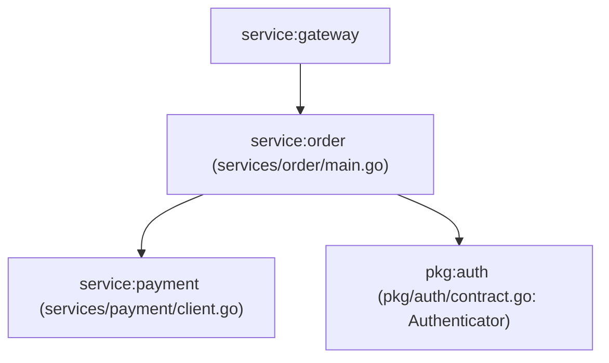

# Codebase Knowledge Graph & Dependency Centrality

## Graph Metrics
- Total Nodes: 3
- Total Edges: 2
- Centrality Hub: `service:order` (In-Degree: 1, Out-Degree: 2)

## Dependency Topology

## Node Registry
- `service:order`: Entrypoint `CreateOrder` (`services/order/main.go`). Callers: `service:gateway`.
- `pkg:auth`: Contract `Authenticator` (`pkg/auth/contract.go`). Callers: `service:order`, `service:gateway`.
- `service:payment`: Method `ProcessPayment` (`services/payment/client.go`). Consumers: `service:order`.
